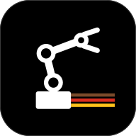
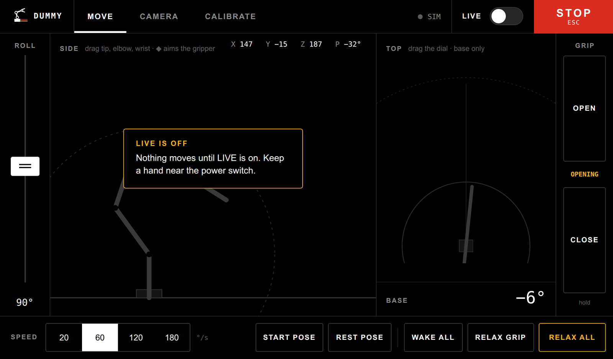
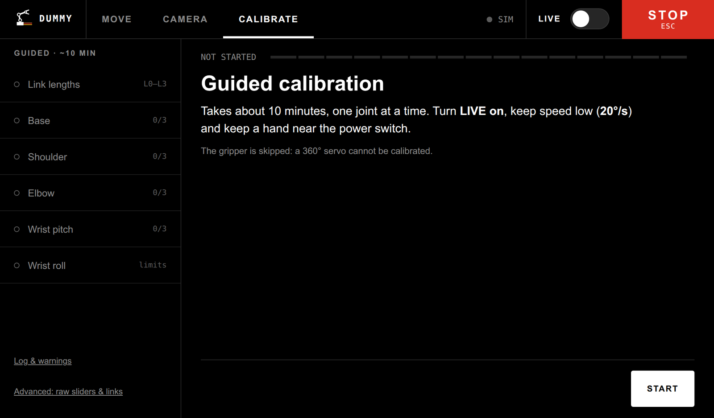
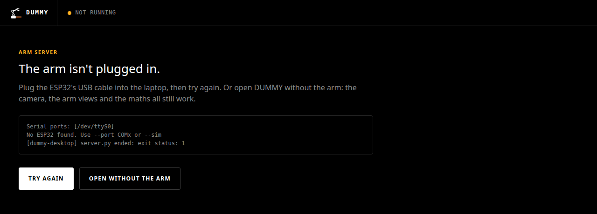

<p align="center"></p>

<h1 align="center">DUMMY</h1>

<p align="center"><b>A budget 6-DOF robot arm that picks things off the table, steered from a touchscreen.</b><br>
Six MG996R servos, an ESP32, one overhead camera, and a lot of calibration.</p>



## What it is

DUMMY is a home-built servo arm on a workbench, with a camera looking down at the table. You drive it
from a web page: from the laptop, or from an old Galaxy Tab propped up next to it.

- **Move it by hand:** drag the arm's tip in the side view, turn the base on the dial, and roll and
  open the gripper. Nothing moves until you switch **LIVE** on, and the big red **STOP** (or Esc) always wins.
- **Tap the table to pick something up:** in the Camera tab, tap a spot on the live video, then
  **HOVER**, **LOWER** or **PICK HERE**. Or type what to look for ("cup", "screwdriver"), let the
  detector find it, and press **PICK**. It picks the object up and hovers over the spot, holding it;
  then **BRING HERE** hands it over to you, or **PUT DOWN** sets it back on the table.
- **Point with your finger:** with **Follow finger** on, the tool hovers over the spot your index
  finger points at, and follows it around the table. Curl the finger and it stays put. **Low / Hover / High**
  pick the hover height.
- **Talk to it:** in the Voice tab, switch on **Wake word** and say *"Dummy, come here"* (follow
  your finger), *"Dummy, start pose"*, *"Dummy, relax"* (park on the desk, then go limp) or *"Dummy,
  stop"*, and about fifty more: *"Dummy, up a bit"*, *"left 3 cm"*, *"close"*, *"pick up the pen"*,
  *"bring it to me"*, *"is the pose OK?"*, *"what can I say?"*. The Commands page on the tab lists
  them all. **Push to talk** (hold the button, or V on a keyboard) is there for testing. A two-minute
  calibration on the same tab tunes it to your mic, your room and your voice.
- **It has a personality:** say just *"Dummy"* and he nods, *"Dummy, are you dumb?"* and he shakes
  his head, *"Dummy, good boy"* and he dances, *"hello"* and he waves, *"thank you"* and he bows,
  *"bad boy"* and he droops. Say something he doesn't get and he tilts his head. Gestures are small,
  checked against the joint limits and the table first, and always end where they started.
- **Calibrate it properly:** a guided wizard takes each joint in turn (about ten minutes), so the
  maths matches the real servos to within millimetres.



### The desktop app
On the laptop, DUMMY is an app in the menu, with its own window and icon. It starts the arm's
server, shows the UI, and stops the server again when you close the window. If the arm isn't
plugged in it says so, and offers to open without it (simulated arm, camera and maths still work).
Each start updates it to the latest `master` first, and your calibration survives the update.



### At the bench, with ATLAS
The workbench tablet's home screen is shared with [ATLAS](https://github.com/tudor-n/atlas), the
owner's notes-and-agents hub: **DUMMY** opens this arm UI, and the arm UI's **‹ HOME** goes back.
While LIVE is on (or a grip button is held), HOME refuses to leave, so the arm is never left moving with no STOP on screen.


## How it works

An ESP32 drives the servos, a Python server does the kinematics and vision, and the operator works
from a browser.

```
browser  ──WebSocket/MJPEG──  server.py (IK, vision, pick logic)  ──USB serial──  ESP32  ──I2C──  PCA9685  ──PWM──  6x MG996R
                                   │
                              USB camera  ──  4x ArUco markers on the table
```

The camera never sees the arm's joints. It sees four ArUco markers whose positions in the
arm's own coordinate frame were measured *by the arm*, and solves for where the camera is
from those. Everything downstream - clicking a point, detecting an object, picking it -
is a ray from the camera onto the fitted table plane, expressed in arm coordinates.

The same camera steers the arm in **Follow finger**: MediaPipe finds the hand, and the ray along
the index finger meets the table where the tool should hover. It's for quick positioning, not
precision.

## Documentation

| | |
|---|---|
| [docs/HARDWARE.md](docs/HARDWARE.md) | The physical build: frame, servos, power, wiring, the quirks that matter |
| [docs/ARCHITECTURE.md](docs/ARCHITECTURE.md) | How the software is put together and why |
| [docs/CALIBRATION.md](docs/CALIBRATION.md) | **Start here when accuracy is wrong.** Every calibration procedure, in dependency order |
| [docs/ROADMAP.md](docs/ROADMAP.md) | Where this is going, and the known-unknowns |
| [TEST_INSTRUCTIONS.md](TEST_INSTRUCTIONS.md) | How to test the current working branch, and what will surprise you |

## Quickstart

```bash
pip install -r requirements.txt
pio run -t upload                      # firmware, once
python server.py --port COM5           # auto-detects a CP210x/CH340 port if omitted
```

Then open <http://localhost:8080>.

**Or as a desktop app (Linux):** `python3 -I -S desktop/launcher.py install --seed-venv .venv --assets-from .`
once, then start **DUMMY** from the launcher. It keeps an installed copy on master by itself
(calibration edits survive updates); see [desktop/README.md](desktop/README.md).

```bash
python server.py --sim                 # no arm; vision and IK still run
python server.py --no-camera           # no camera; arm only
python server.py --camera 1 --http 8080
python test_geometry.py                # offline maths tests, no hardware needed
python test_finger.py                  # offline finger-follow tests
python test_voice.py                   # offline voice tests
python test_gestures.py                # offline personality tests
```

`ultralytics` (Detect), `mediapipe` (Follow finger) and `faster-whisper` (Voice) are optional:
without them the rest of the UI still works. Follow downloads its hand model into `weights/` the
first time you switch it on, and Voice its speech model (~0.5 GB, into the Hugging Face cache).

The arm boots limp and stays limp. Nothing moves until you turn **Live** on, which sends
`R 0` to engage the servos. **STOP** (or Esc) cancels any running pick and brakes the
gripper.

## Repository map

| Path | What it is |
|---|---|
| `server.py` | The brain. Kinematics, 50 Hz control loop, HTTP/WebSocket, pick sequencing |
| `vision.py` | Camera thread, ArUco pose, table raycast, YOLO-World detection, MJPEG overlay |
| `finger.py` | Finger follow: MediaPipe hand tracking and the follow state machine. Knows nothing about the arm |
| `cam_panel.js` | Camera tab, injected into `index.html` by the server at serve time |
| `hearing.py` | Voice: mic, speech detection, Whisper, and turning what was said into a command. Knows nothing about the arm |
| `voice_panel.js` | Voice tab, injected like the Camera tab |
| `voice.json` | Voice settings and what calibration learned about your voice |
| `gestures.py` | Personality: the nod, shake and dance choreography and its planner. Knows nothing about the arm |
| `index.html` | Move and Calibrate tabs; the canvas arm views and the calibration wizard |
| `src/main.c` | ESP32 firmware. A deliberately dumb executor - see HARDWARE.md |
| `config.json` | Link lengths, joint zero/sign/limits, tool offsets |
| `vision.json` | Arm-measured marker positions, pick settings, roll calibration |
| `camera_matrix.npy`, `dist_coeffs.npy`, `camera_calib.json` | Camera intrinsics and their provenance |
| `calibrate_camera.py` | Checkerboard intrinsics calibration |
| `test_markers.py` | Pre-flight: are all four ArUco markers visible? |
| `test_geometry.py` | Offline tests for the pose and kinematics maths |
| `test_finger.py` | Offline tests for pointing detection and the follow state machine |
| `test_voice.py` | Offline tests for the voice matcher, segmenter and calibration |
| `test_gestures.py` | Offline tests for gesture planning and how the server runs gestures |
| `desktop/` | DUMMY, the desktop app: a Tauri window around the UI, and the launcher that installs and updates it |
| `docs/brand/` | The DUMMY logo: marks and launcher tiles (dark and light) |

## Current state

**Working, and closer to good than it has been - but not finished.** The arm picks objects off
the table reasonably reliably.

| | |
|---|---|
| Camera pose | Solid. Mean reprojection ~1.8 px, camera position steady |
| Marker model | Hand-measured, independently tape-checked to 7 mm worst |
| Arm kinematics | All four joints calibrated. ~11 mm at table height (cross-validated) |
| Grasp depth | Still being tuned |
| Tool model | Along-axis length fitted; off-axis offsets unmeasured |
| Finger follow | Works on the real arm (2026-10-24). The Low / Hover / High buttons are new and not yet tried on hardware |
| Desktop app | DUMMY in the launcher, self-updating from master (2026-10-24). Not yet tried with the arm plugged in |
| Voice | Tested with synthetic speech (340 clips, no wrong actions) and the webcam mic. The ~50 newer commands (2026-10-25) are tested offline against the control loop, not yet spoken to the arm |
| Personality | Nod, shake, dance, wave, bow, head tilt and droop, tested against the control loop, not yet on the real arm |
| Pick and rest | A pick now holds the object at hover; hand-over and put-down are new. The rest pose parks the tool on the desk (2026-10-25); how far a limp arm settles from there is still to be seen on the bench |

The remaining errors are millimetres rather than centimetres. Getting from "works most of the
time" to "works every time" is what [docs/ROADMAP.md](docs/ROADMAP.md) tracks - it also records
what was wrong, how each fault was found, and which hypotheses were ruled out and why.

Offline tests: `python test_geometry.py` and `python test_finger.py` (no hardware needed).
